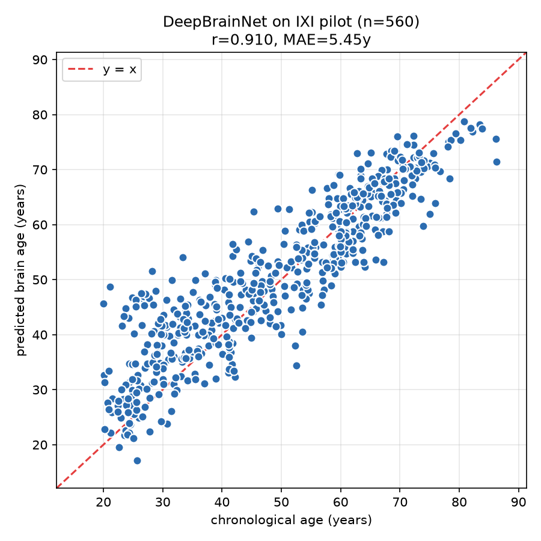
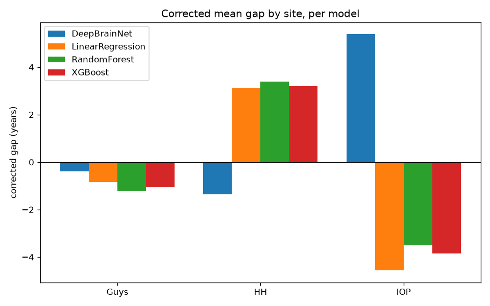
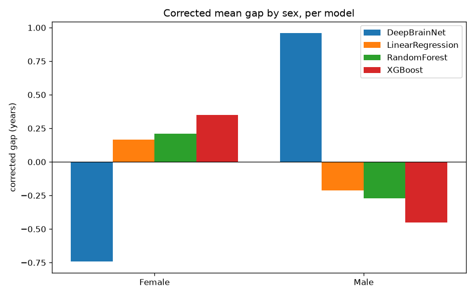
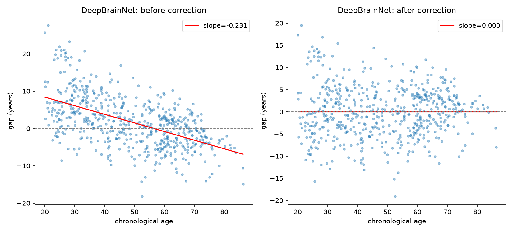
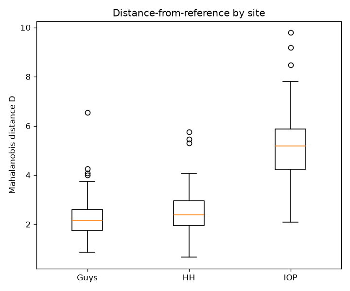
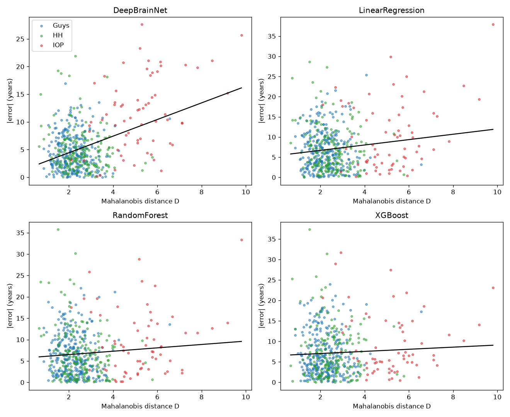
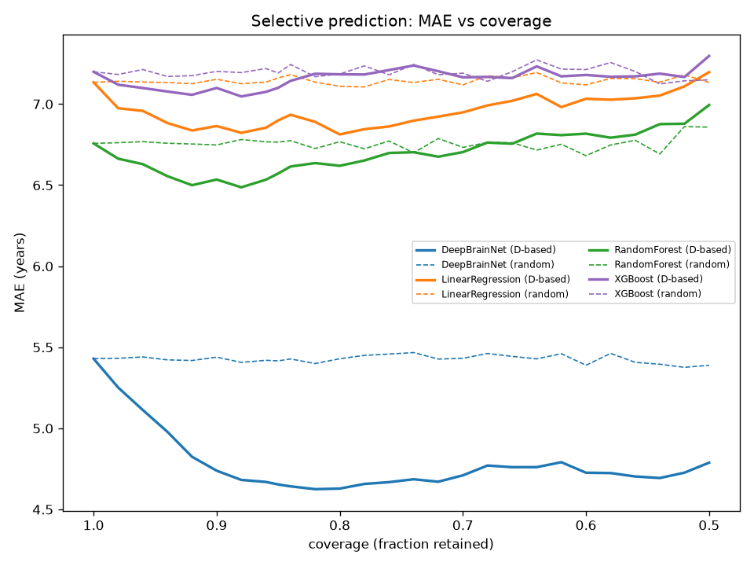
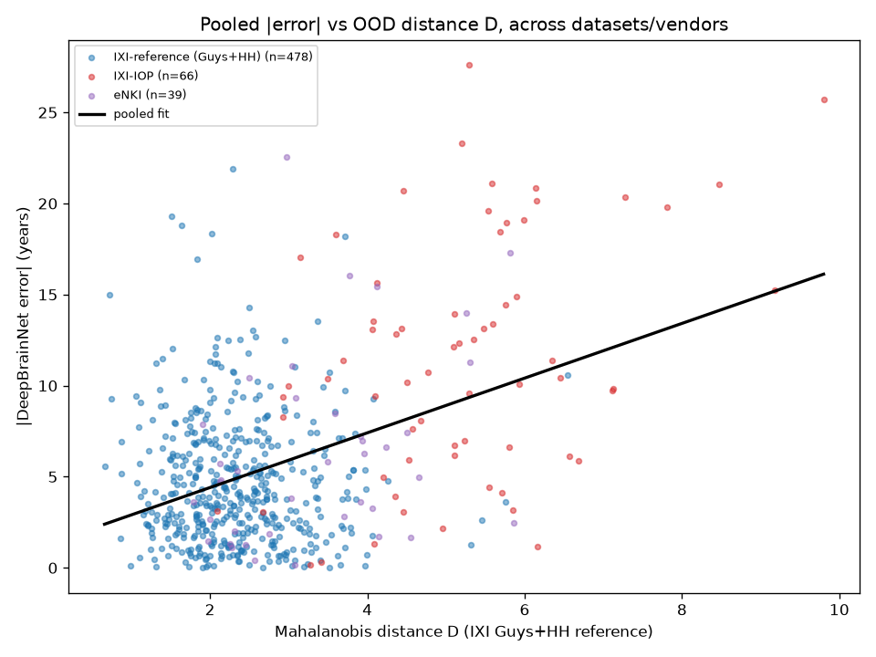
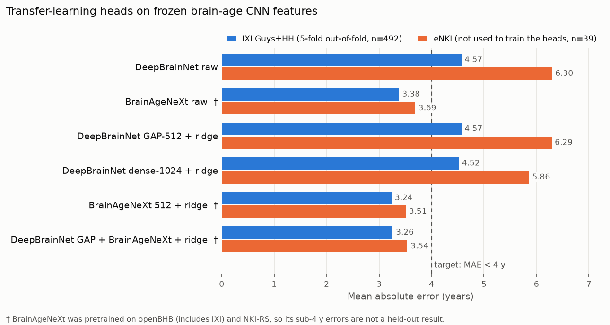

# iAudit - Brain-Age Fairness Audit

A fairness audit of brain-age prediction on the [IXI](https://brain-development.org/ixi-dataset/)
neuroimaging dataset. DeepBrainNet (a CNN trained on raw T1 MRI) is compared
against three plain tabular regressors trained on simple volumetric features,
to test whether the fairness disparities found in one architecture are
scanner/acquisition artifacts (replicate across architectures) or
model-specific.

## Pipeline

| Stage | What | Script |
|---|---|---|
| 0–1 | Environment setup; join T1 filenames to IXI demographics | `scripts/load_demographics.py`, `scripts/fetch_ixi_nitrc.py` |
| 2 | Single-scan DeepBrainNet smoke test | `scripts/predict_one.py` |
| 3 | 20-scan pilot batch, pass/fail gate | `scripts/run_pilot.py` |
| 4A | Full-cohort (n=560) DeepBrainNet inference, checkpointed | `scripts/run_full.py` |
| 5 | Fairness audit: pooled age-bias correction, subgroup stats | `scripts/fairness_audit.py` |
| T1 | Volumetric feature extraction (`deep_atropos`, 6-tissue segmentation) | `scripts/extract_features.py` |
| T2 | Train 3 plain tabular models (LinearRegression, RandomForest, XGBoost), leak-free 5-fold out-of-fold predictions | `scripts/train_tabular.py` |
| T3 | Write tabular predictions in shared schema; re-run the audit unchanged on all 4 models | `scripts/write_tabular_predictions.py` |
| T4 | Cross-model comparison on the common cohort | `scripts/compare_models.py` |
| V | IOP feature-distribution check (age-adjusted, is IOP off-distribution at the data level?) | `scripts/check_iop_features.py` |
| - | Unsupervised Mahalanobis reliability score (feature-space distance from the "seen" Guys+HH distribution) | `scripts/reliability_score.py` |
| - | Theory-test battery: LSO penalty, harmonization, sex-bias confound, within-distribution OOD, site-aware correction | `scripts/theory_test_battery.py`, `scripts/task0_suppressor_check.py` |
| R1 | Traveling Human Phantom (ds000206): fetch, extract features, score vendor effect on the reliability distance | `scripts/thp_fetch_metadata.py`, `scripts/thp_fetch_t1.py`, `scripts/thp_extract_features.py`, `scripts/thp_reliability_score.py` |
| R2 | eNKI Rockland external cohort: fetch, features + DeepBrainNet, verify the reliability score off-IXI | `scripts/enki_fetch_t1.py`, `scripts/enki_extract_and_predict.py`, `scripts/stage_r2_verify.py` |
| R3 | Pooled IXI + eNKI test of error vs reliability distance | `scripts/stage_r3_pooled.py` |
| F1 | Frozen-CNN feature extraction (DeepBrainNet 512/1024-d, BrainAgeNeXt 512-d) + ridge transfer heads, run on Colab T4 | `colab/iaudit_colab_auto.ipynb` (built by `colab/build_auto.py`); local: `scripts/dbn_embed.py`, `scripts/bang_orientation_check.py` |
| F2 | Transfer-learning MAE figure | `scripts/plot_transfer_head_mae.py` |
| F3 | BrainAgeNeXt fairness audit (Stage 5 method, same 492 subjects as DeepBrainNet) | `scripts/bang_fairness_audit.py` |

Every stage is checkpointed/resumable where it runs long, and every number
in `results/` comes from actually running these scripts on the real IXI
cohort - nothing is hand-entered.

## Data

- Source: T1 NIfTI scans and demographics (`IXI.xls`) via NITRC's public
  XNAT mirror (the official IXI host returns 403 for direct downloads).
- 560 subjects with a usable T1 scan and known age/sex/site/ethnicity;
  544 of those also have volumetric features (16 dropped to transient
  `deep_atropos` MemoryErrors during segmentation, caught and logged -
  see `scripts/extract_features.py`).
- Sites: Guys, HH, IOP (three different scanners/acquisition protocols).

External cohorts used to test whether the findings travel beyond IXI:

| Cohort | Source | Scans | Used for | Notes |
|---|---|---|---|---|
| Traveling Human Phantom (ds000206) | OpenNeuro | 65 (5 people, 8 sites) | R1: vendor effect on the reliability distance | Siemens + Philips only (0 GE scans), no age ground truth |
| eNKI Rockland | FCP-INDI public S3 (no DUA) | 39 | R2/R3 and the transfer-learning test set | All Siemens TrioTim; community-volunteer sample, not clinically screened; capped at 39 by ~30 KB/s S3 throughput |

Large inputs (T1 scans, model caches, extracted features) live outside the
repo; only scripts, tables and figures are committed.

## Setup

```
python -m venv venv
venv\Scripts\pip install -r requirements.txt
```

DeepBrainNet ships as a legacy Keras-2 model; set `TF_USE_LEGACY_KERAS=1`
before importing TensorFlow (already done in every script that needs it).

BrainAgeNeXt needs PyTorch, which is kept in a separate environment to avoid
TensorFlow/PyTorch conflicts:

```
python -m venv venv_torch
venv_torch\Scripts\pip install -r requirements-torch.txt --extra-index-url https://download.pytorch.org/whl/cpu
```

### Running the transfer-learning stage on Colab

On a laptop CPU, DeepBrainNet preprocessing takes ~165 s/scan and
BrainAgeNeXt ~190 s/scan. `colab/iaudit_colab_auto.ipynb` runs both
without any uploads:

1. Open it in Colab, set *Runtime > Change runtime type > T4 GPU*, then *Run all* and allow Drive access.
2. If Colab disconnects, *Run all* again - every scan is checkpointed to `MyDrive/iAuditAge/outputs/` and never redone.

Built-in safeguards: every download is MD5-checked against the files used
locally; each session first re-runs a reference scan and must reproduce the
local result (within 1y, feature r >= 0.98); drift and failure watchdogs
stop the run and release the runtime. The notebook is generated by
`colab/build_auto.py`, which embeds the scan list, URLs and checksums.

## Results

See `results/SESSION_REPORT.md` for the full Stage 0–5 writeup. Summary of
the full pipeline (Stage 0 through the reliability score) below.

### Per-model accuracy (CV / out-of-fold, n=544 common cohort)

| Model | MAE | R² | Pearson r |
|---|---|---|---|
| DeepBrainNet (CNN, full n=560) | 5.45y | - | 0.910 |
| LinearRegression | 7.13y | 0.695 | 0.834 |
| RandomForest | 6.76y | 0.716 | 0.846 |
| XGBoost | 7.20y | 0.681 | 0.827 |

Tabular models are less accurate than the CNN by design (no hyperparameter
tuning, simple volumetric features) - the point of comparison is bias
*shape*, not accuracy.

<p align="center">
  
</p>
<p align="center"><em>DeepBrainNet predicted vs actual age, full cohort (n=560, r=0.910)</em></p>

### Cross-model fairness comparison (Stage T4, common cohort n=544)

**MAE by site - IOP is the worst site for all 4 models:**

| Site | DeepBrainNet | LinearRegression | RandomForest | XGBoost |
|---|---|---|---|---|
| Guys | 4.43y | 6.62y | 6.24y | 6.72y |
| HH | 4.87y | 6.84y | 6.67y | 7.25y |
| **IOP** | **11.49y** | **10.25y** | **9.33y** | **9.23y** |

This is the headline finding: IOP degrades every architecture tested,
regardless of whether the model sees the raw image (DeepBrainNet) or
simple tissue-volume features (tabular models) - consistent with a
scanner/acquisition artifact at the data level, not a DeepBrainNet quirk.

<p align="center">
  
  
</p>
<p align="center"><em>Corrected gap by site (left) and sex (right), all 4 models side by side</em></p>

Stage V confirms this mechanistically for the tabular pathway: 5/6
tissue-volume fractions remain significantly shifted at IOP after
age-adjustment (Bonferroni-corrected Mann-Whitney U), i.e. IOP scans are
genuinely off-distribution at the feature level, independent of the
younger age mix at that site.

The male-older/female-younger directional bias seen in DeepBrainNet does
**not** cleanly replicate in the tabular models - see
`results/fairness_checklist.md` and `results/bias_report.csv` for the
full subgroup breakdown.

<p align="center">
  
</p>
<p align="center"><em>Bland-Altman: gap vs age, before/after correction (DeepBrainNet; see results/fig_bland_altman_*.png for the other 3 models)</em></p>

### Unsupervised reliability score

A Mahalanobis distance from the Guys+HH ("seen") feature distribution,
fit **without ever using IOP**, was tested as a model-agnostic reliability
signal:

- **Recovers IOP unsupervised:** ROC AUC = 0.967 (distance alone, no site
  labels used to fit it).
- **Predicts per-subject error, age-controlled:** real and significant for
  DeepBrainNet (partial Spearman r=0.215, p<0.00001); null for all 3
  tabular models (p>0.5) - a genuine negative result, not glossed over.
- **Selective prediction beats random abstention** for all 4 models, but
  the effect size is only practically meaningful for DeepBrainNet
  (0.80y MAE drop at 80% coverage vs ~0.02–0.32y for the tabular models).

<p align="center">
  
  
</p>
<p align="center"><em>Left: distance-from-reference by site (IOP separates cleanly, AUC=0.967). Right: per-subject error vs distance, per model.</em></p>

<p align="center">
  
</p>
<p align="center"><em>MAE vs coverage as high-distance scans are dropped - reliability-score-based (solid) vs random abstention (dashed)</em></p>

### External validation of the reliability score (Stages R1-R3)

| Stage | Question | Result | Verdict |
|---|---|---|---|
| R1 - THP | Does scanner vendor shift the distance D within the same person? | Philips mean D 5.01 vs Siemens 3.81; paired Wilcoxon p=0.0625 (the smallest p a 5-pair test can reach) | Not significant - underpowered, not disproven. The "IOP is GE" idea stays untested (no GE scans exist in THP) |
| R2 - eNKI | Does D flag a new, unseen cohort? | eNKI mean D 3.37 vs IXI reference 2.33; AUC 0.774 | Yes |
| R2 - eNKI | Does D predict DeepBrainNet error on eNKI alone? | Age-controlled partial Spearman r=0.217, p=0.184 (n=39) | Not significant on its own |
| R3 - pooled | Does D predict error across IXI + eNKI? | Partial Spearman r=0.220, p=7.99e-08 (n=583) | **Supported** |

DeepBrainNet MAE rises from 4.59y on the IXI reference sites to 6.28y on
eNKI, in line with eNKI sitting further from the reference distribution.

<p align="center">
  
</p>
<p align="center"><em>Pooled IXI + eNKI (n=583): DeepBrainNet absolute error vs distance from the Guys+HH reference</em></p>

### Second CNN: BrainAgeNeXt

[BrainAgeNeXt](https://github.com/FrancescoLR/BrainAgeNeXt)
([La Rosa et al., Imaging Neuroscience 2025](https://doi.org/10.1162/imag_a_00487))
was added as a second, newer brain-age CNN to compare against DeepBrainNet.

| | DeepBrainNet | BrainAgeNeXt |
|---|---|---|
| Architecture | VGG16-style 2D CNN, 80 axial slices, median of slice predictions | MedNeXt (ConvNeXt-style) 3D CNN on the whole 160×192×160 volume |
| Ensemble | single model | 5 models, median prediction |
| Training data (per its paper) | not checked here | 11,574 healthy scans, 33 datasets, ages 5–95, 3T and 7T - **including openBHB (contains IXI) and NKI-RS** |
| Framework / environment | TensorFlow (`requirements.txt`) | PyTorch (`requirements-torch.txt`) |
| Speed in this project | ~165 s/scan on laptop CPU (mostly ANTs registration) | ~190 s/scan laptop CPU, **~5 s/scan on a Colab T4** |

How it was run (`colab/iaudit_colab_auto.ipynb`):

- **Same preprocessing as DeepBrainNet.** BrainAgeNeXt reads the skull-stripped,
  bias-corrected, MNI-registered volume that the DeepBrainNet step saves,
  so both models see the identical brain for every scan.
- **Orientation check.** ANTs and BrainAgeNeXt's expected MNI space can differ
  by an axis flip, so all 4 orientations (as-is, flip L-R / A-P / S-I) were
  scored on 20 Guys+HH scans and the best one was locked for the whole run
  (recorded in the notebook's `outputs/bang_orientation.json`). The run would
  have stopped if even the best orientation had MAE > 10y.
- **Reproduction check.** Each Colab session first re-ran IXI002 in all 4
  orientations and had to match the laptop CPU result within 1.5y.
- **Features.** For every scan the 512-d encoder output of each of the 5
  models was saved alongside the prediction, for the transfer heads below.

Results on the 531 scans (IXI Guys+HH n=492, eNKI n=39):

- Raw MAE **3.38y on IXI** and **3.69y on eNKI**, against DeepBrainNet's 4.57y
  and 6.30y - about 1.2y and 2.6y better.
- It barely degrades from IXI to eNKI (+0.31y) where DeepBrainNet degrades by
  +1.73y.
- **Caveat:** both cohorts very likely overlap its training data (IXI via
  openBHB; NKI-RS is the Rockland sample eNKI comes from). The small IXI-to-eNKI
  drop is more likely memory than robustness, and none of these numbers is a
  held-out result.

Not done yet for BrainAgeNeXt:

- **Fairness audit** (sex / site / ethnicity, the Stage 5 method) -
  `scripts/bang_fairness_audit.py` is ready; it needs the per-scan
  `transfer_head_predictions.csv` from the Colab run's Google Drive outputs.
- **IOP** - not included in the Colab run, so it is unknown whether
  BrainAgeNeXt also fails on the IOP scanner (DeepBrainNet: 11.49y).
- **Reliability score** - not yet tested against BrainAgeNeXt's errors.
- **Clean held-out test** - a cohort the paper used only for testing (e.g.
  SALD, DLBS).

### Transfer learning toward MAE < 4 years (Stage F1)

Goal: reach MAE < 4y without GPU fine-tuning. Both CNNs were frozen; their
internal features were extracted for every scan, and a small ridge head was
trained on IXI Guys+HH only. IOP was left out of this experiment entirely.
Run on a Colab T4 (531 scans, no failed scans, no safety stops).

| Model | IXI Guys+HH (5-fold out-of-fold, n=492) | eNKI (n=39) |
|---|---|---|
| DeepBrainNet, raw | 4.57y | 6.30y |
| DeepBrainNet GAP-512 + ridge | 4.57y | 6.29y |
| DeepBrainNet dense-1024 + ridge | 4.52y | 5.86y |
| BrainAgeNeXt, raw † | 3.38y | 3.69y |
| BrainAgeNeXt 512 + ridge † | **3.24y** | **3.51y** |
| DeepBrainNet GAP + BrainAgeNeXt + ridge † | 3.26y | 3.54y |

- A ridge head on DeepBrainNet's frozen features barely helps (-0.05y on
  IXI, -0.4y on eNKI); DeepBrainNet stays above 4y.
- BrainAgeNeXt is already under 4y with no head; the head adds ~0.15y.
  Combining both CNNs adds nothing over BrainAgeNeXt alone.
- **† Not a held-out result.** BrainAgeNeXt's training set
  ([La Rosa et al., Imaging Neuroscience](https://pmc.ncbi.nlm.nih.gov/articles/PMC12319810/), Table 1)
  includes **openBHB**, which pools IXI among ten public datasets, and
  **NKI-RS**, the same Rockland sample eNKI comes from. Its sub-4y errors
  here are on data it was very likely trained on; our 5-fold CV cannot
  remove leakage that happened during pretraining. DeepBrainNet's training
  sets have not been checked the same way.
- A clean test needs a cohort BrainAgeNeXt only used for *testing* (e.g.
  SALD or DLBS) - not yet run.

<p align="center">
  
</p>
<p align="center"><em>MAE per model and cohort; dashed line = 4y target. † = pretraining overlaps the test cohorts.</em></p>

Per-scan features and predictions from this run are kept on Google Drive
(`outputs/` of the notebook), not in the repo; `results/transfer_head_mae.csv`
holds the summary table.

### All figures

| | |
|---|---|
| `fig_pred_vs_actual.png` | DeepBrainNet predicted vs actual age |
| `fig_boxplot_sex_*.png` | Corrected gap distribution by sex, per model |
| `fig_mae_by_site_*.png` | MAE by site, per model |
| `fig_crossmodel_site_bias.png` / `_sex_bias.png` | Corrected gap by site/sex, all 4 models side by side |
| `fig_bland_altman_*.png` | Gap vs age, before/after correction, per model |
| `fig_multimodel_subgroup_comparison.png` | Multi-model subgroup comparison scaffold |
| `fig_distance_by_site.png` | Reliability-score distance by site (IOP separation) |
| `fig_error_vs_distance.png` | Per-subject error vs reliability score, per model |
| `fig_selective_prediction.png` | MAE vs coverage, reliability-score-based vs random abstention |
| `fig_pooled_error_vs_D.png` | Pooled IXI + eNKI DeepBrainNet error vs reliability distance (R3) |
| `fig_transfer_head_mae.png` | Transfer-learning MAE per model on IXI and eNKI (F1) |
